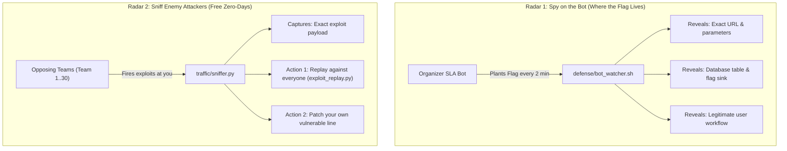

# 🧠 Master Game Dynamics & In-Competition Cheat Codes

> **OFFLINE GUIDE FOR 24-HOUR ATTACK & DEFENSE CTF**  
> Read this manual during the match whenever you are unsure of your next move.

---

## 📑 Table of Contents
1. [The Golden Rules (Never Break These)](#1-the-golden-rules-never-break-these)
2. [The "Tick" Lifecycle & Timing Math](#2-the-tick-lifecycle--timing-math)
3. [The Twin-Radar Intelligence Strategy](#3-the-twin-radar-intelligence-strategy)
   - [Radar 1: Spying on the Organizer SLA Bot (The Creator)](#radar-1-spying-on-the-organizer-sla-bot-the-creator)
   - [Radar 2: Sniffing Enemy Attackers (The Thieves)](#radar-2-sniffing-enemy-attackers-the-thieves)
4. [Surgical Patching Tricks (Preserving SLA)](#4-surgical-patching-tricks-preserving-sla)
5. [Database Flag Ordering Quirks](#5-database-flag-ordering-quirks)
6. [What to Do When All 30 Teams Are Stuck](#6-what-to-do-when-all-30-teams-are-stuck)
7. [The 3+1 Player Fatigue & Graveyard Shift Strategy](#7-the-31-player-fatigue--graveyard-shift-strategy)

---

## 1. The Golden Rules (Never Break These)

| Strict Rule | Why It Matters | Disqualification Risk |
| :--- | :--- | :--- |
| **DO NOT Turn Down Enemy Services** | Never crash, fork bomb, or drop databases on other teams. Your exploit must **quietly read the flag and exit cleanly**. | 🚨 **Instant Disqualification.** Organizer monitoring traces crashes back to your IP. |
| **NO Firewall / iptables Edits** | You cannot block enemy IPs via iptables. Defend exclusively at Layer 7 (code patches or L7 proxy). | 🚨 **Severe Penalty / Ban.** |
| **Mandatory >= 2.0s Delay** | Hardcoded `time.sleep(2.1)` in all automated loops. | 🚨 **Anti-DDoS Violation.** |
| **Sniff ONLY Your Own Box** | Sniff traffic only on your assigned interfaces (`eth0`, `docker0`). | 🚨 **Network Violation.** |

---

## 2. The "Tick" Lifecycle & Timing Math

1. **How the Game Moves:** The match is divided into **Ticks / Rounds** (typically 2 to 3 minutes each).
2. **Dynamic Flags:** In every tick, the organizer bot visits every team and plants a **brand new flag**.
3. **Expiry Window:** Flags are usually valid for only **1 to 3 ticks (2 to 6 minutes)**. Old flags expire and give 0 points.
4. **The Attack Loop Math:**
   $$\text{29 target teams} \times \text{2.1s delay per team} = \mathbf{60.9 \text{ seconds}}$$
   *Your script takes ~61 seconds to attack all teams, finishing well within a 2-minute tick with 100% fresh flags!*

---

## 3. The Twin-Radar Intelligence Strategy



### Radar 1: Spying on the Organizer SLA Bot (The Creator)
The bot connects directly to your server every 2 minutes. Its traffic gives away the entire challenge architecture!

#### How to Watch the Bot Live:
```bash
# 1. Using our dedicated bot watcher script:
chmod +x defense/bot_watcher.sh
./defense/bot_watcher.sh

# 2. Or watch raw web server access logs:
sudo tail -f /var/log/nginx/access.log /var/log/apache2/access.log 2>/dev/null

# 3. Or sniff incoming HTTP requests:
sudo tshark -i any -Y "http.request" -T fields -e ip.src -e http.request.method -e http.request.uri
```

#### What the Bot Reveals:
* If the bot sends `POST /api/notes/new` with `{"content": "FLAG{...}"}`, you instantly know:
  - The flag is stored in the **notes** feature.
  - You do not need to audit 50 random files—only audit the file handling `/api/notes/`!
  - Ask: *"The bot had to log in to read note #142. How can an unauthorized stranger read note #142?"* (IDOR, SQLi, LFI).

---

### Radar 2: Sniffing Enemy Attackers (The Thieves)
If another team finds a vulnerability before you do, **let them do the work!**

1. Keep `sudo python3 traffic/sniffer.py eth0 &` running constantly.
2. When Team 7 exploits your service, the sniffer dumps their exact payload to `traffic/captured_exploits/`.
3. **The 2-Minute Counter-Strike:**
   ```bash
   # Replay Team 7's payload against all other 28 teams!
   python3 attack/exploit_replay.py traffic/captured_exploits/latest.bin --port 8080
   ```
4. Now look at what Team 7 sent in `traffic_l7.log`, find the line of code they attacked, and patch it on your box!

---

## 4. Surgical Patching Tricks (Preserving SLA)

> **Golden Rule of Patching:**  
> Never write beautiful, complex code. Write dirty, surgical fixes that block the exploit without breaking the SLA checker.

### Trick 1: The "Length-Limit" Filter (Blocks 90% of Web Exploits)
Exploits require long strings (`UNION SELECT ...`, RCE one-liners, path traversals). Real SLA bots send short, normal data (`test`, `john123`).
```php
// In PHP: Truncate or drop payload if too long
if (strlen($_POST['search']) > 32) {
    die("OK"); // Return 200 OK so SLA checker doesn't fail!
}
```

### Trick 2: Safe Type-Casting (Kills SQL Injection Instantly)
If an endpoint takes an ID:
```php
// Vulnerable:
$id = $_GET['id'];
$query = "SELECT * FROM posts WHERE id = '$id'";

// Patched surgically:
$id = intval($_GET['id']); // Drops any SQL injection strings!
$query = "SELECT * FROM posts WHERE id = $id";
```

### Trick 3: Binary NOP-ing (Pwn Challenges)
If a binary has a backdoor function calling `system("/bin/sh")`:
1. Open the binary in Ghidra.
2. Click on the dangerous `CALL` instruction.
3. Press **`Ctrl + Shift + G`** (Patch Instruction) $\rightarrow$ replace with `NOP` (`0x90`).
4. Or patch the first byte of the backdoor function with `0xC3` (`RET`) to make it return immediately!
5. Export program $\rightarrow$ Original File $\rightarrow$ replace live binary $\rightarrow$ restart service.

---

## 5. Database Flag Ordering Quirks

If the challenge stores flags in a database table:
* In Tick 1: Table has 1 row (`FLAG #1`).
* In Tick 30: Table has 30 rows (`FLAG #1` through `FLAG #30`).
* Only the **newest** flag is valid! Old flags are expired.

⚠️ **Exploit Rule:** When writing SQL injection payloads, **always sort by descending ID**:
```sql
-- BAD (Reads the oldest, expired flag from 2 hours ago):
' UNION SELECT null, flag, null FROM flags-- -

-- GOOD (Always extracts the newest, unexpired active flag):
' UNION SELECT null, flag, null FROM flags ORDER BY id DESC LIMIT 1-- -
```

---

## 6. What to Do When All 30 Teams Are Stuck

If nobody is capturing flags and the scoreboard has flatlined:
1. **You are safe:** As long as your service is **GREEN**, you are tied for 1st place.
2. **DO NOT break your service** by testing random, untested code changes in production.
3. **Execute the Deadlock Protocol:**
   - Run `defense/bot_watcher.sh` to watch the SLA bot's latest movements.
   - Search the codebase for custom code files (`find . -mmin -120` or look for files not part of standard frameworks).
   - If Service B (Binary) is impossibly hard, **pivot all players to Service A (Web) or Service C**.
4. **First-Blood Monopoly:** The first team to break the deadlock gets an uncontested scoring run against all 29 teams for several ticks!

---

## 7. The 3+1 Player Fatigue & Graveyard Shift Strategy

A 24-hour match is won between **02:00 AM and 06:00 AM**. Most teams crash, fall asleep, or break their own services.

```mermaid
gantt
    title Team Rotation Schedule (10:00 AM - 10:00 AM)
    dateFormat  HH:mm
    axisFormat  %H:%M
    
    section Player 1 (Defense Lead)
    Active (Setup & Triage)   :10:00, 6h
    Active (Routine Defense)   :16:00, 6h
    Sleep Block (Mandatory)   :22:00, 4h
    Graveyard Defense Lead     :02:00, 8h

    section Player 2 (Attack Lead)
    Active (Automation Setup) :10:00, 6h
    Active (Exploit Engine)   :16:00, 6h
    Active (Night Raids)      :22:00, 4h
    Sleep Block (Mandatory)   :02:00, 4h
    Morning Final Push        :06:00, 4h

    section Player 3 (Vulnerability/Rev)
    Active (Binary/Web Audits):10:00, 6h
    Sleep Block (Mandatory)   :16:00, 4h
    Active (Phase 1 Final)    :20:00, 2h
    SUBBED OUT AT PHASE 2      :22:00, 12h

    section Player 4 (Substitute)
    Physical Ops & Rest       :10:00, 12h
    SUBBED IN FOR PHASE 2      :22:00, 12h
```



### The Secret Weapon: Player 4 (Substitute)
* Player 4 stays rested and manages hardware, cables, and food during Phase 1.
* When the substitution window opens between Phase 1 and Phase 2 (usually around evening/night):
  - **Tag Player 4 in** to replace Player 3 (whose brain is fried from reverse engineering).
  - Player 4 enters the arena with **100% full cognitive energy** to dominate the overnight hours!
